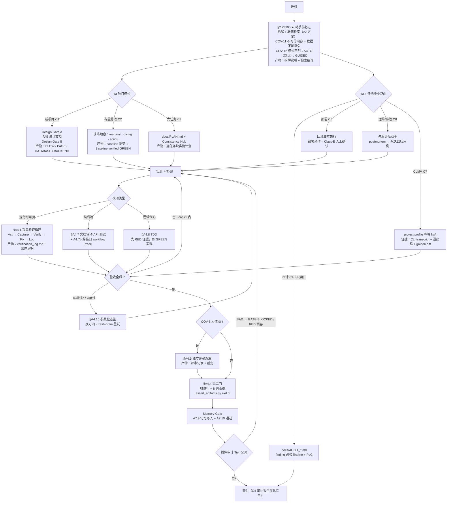

# vibeweaver-dsh

**vibeweaver 的 DeepSeek Harness (dsh) 专属版本** —— 将 [vibeweaver](https://github.com/logandoo/vibeweaver) 编码规范封装为 dsh 插件 bundle（`engines.dsh: ">=0.1.0-rc.6"`，实测覆盖 0.1.0-rc.6 / 0.1.5-rc.3 / 0.2.1-rc.3）：契约本体一字不改，机械执行层换成 dsh 的 Cordis 插件机制。

> 本仓库是 vibeweaver 的 dsh harness 专属发行版：原技能面向 opencode，本版本面向 DeepSeek Harness（jsonrpc-agent / headless CLI），非通用替代品。

## 它是什么

## 2026-10-27：本机升级 0.2.1-rc.4 + 波次 B（上下文管理移植）

- **本机 dsh 升级**：`~/.dsh/profiles/node_modules` 是一套指向 npx 缓存的符号链接农场（597 条）。改为重指向稳定运行时 `~/.dsh/runtime/0.2.1-rc.4`（补 261 条缺失链接，含此前不存在的 `dsh-working-directory`），旧链接清单留档可回滚。四个 profile（headless / vibe-arm-a / vibe-arm-b / web）都能 compose。
- **真实会话 E2E（判据 #7 补齐）**：真 dsh 0.2.1-rc.4 跑编码任务 → 插件注入 1 条 `{id:<uuid>, role:"user", source:{kind:"dsh-vibeweaver"}}` → `--session-id` 重载 **0 处 corrupt**；两个负对照在真二进制上分别报 `producer-owned source kind`（旧 kind）与 `lacks an identified message`（去掉 id/role）。冒烟 (3) 因此从"永远 SKIP"变成真断言（无凭据时仍如实 SKIP）。
- **波次 B（上下文管理移植）**：B1 压缩边界投**工作笔记原文**（≤4KB，超长截断）而不是三行静态文案；B2 写笔记时留**磁盘快照**，笔记被蒸馏删除后仍能投；B3 每根/每会话**首次写入**投一行重入指针 + 投递遥测（`.vibeweaver/state.json`，且修掉了 stall observer 会整对象重置、把遥测一起抹掉的缺陷）；B4 **子代理会话不投激活卡**（`header.origin === "subagent"`，刻意不用 fork 血缘判定）；B5 卡面补 `§V9 收官顺序` / `§V12 合法停止`，四路径 × 三档 12 组合实测 **7817-7968B**。
- **遗留项收口**：`engines.dsh` 加**上限** `<0.3.0`（真机验证：低于/高于范围时 dsh 会 skip 该 bundle 并给豁免命令）；四类守卫盲区补齐——`/bin/rm` 绝对路径、反斜杠续行、`require('rimraf').sync`、`os.exec*` 的 argv `-c` 载荷（每条都有"改动前失败"的 RED 钉）。
- **验证**：unit **176/176**；守卫 PoC 26 例；上游 v4 admission 探针与真 cordis 探针在 rc.4 上 PASS；`assert_artifacts.py --existing --final` 62/62。

## 2026-10-26：dsh 0.2.1-rc.3 兼容波次 A（两条 BLOCKER + 守卫面补全）

依据 `docs/FIXES_20261026_dsh_compat_and_context.md`（上游 API 事实全部对 0.2.1-rc.3 实包复测，非文档转述）：

- **A1 消息源自有 kind + 完整身份（BLOCKER-1）**：注入消息的 `source` 从 `{kind:"plugin", plugin:"dsh-vibeweaver"}` 改为 `{kind:"dsh-vibeweaver"}`，并且**必须带 `id` + `role:"user"`**（评审 R2 补：只改 kind 仍读不回来——`dsh-agent-loop` 原样落盘不补身份，而读侧 `assertMessageEventShape` 要求每条 `user/message` 有非空 id）。0.2.x 的 `MessageSourceMap` 取消了 catch-all `plugin`，写侧照收、**读侧 v4 admission 直接抛 `SessionFormatError`**（`worker.cjs:11641`）——注入过激活卡的会话再也打不开。旧读侧对未知 kind 放行，向后兼容。认证不用模型：`tests/v3_compat_probe.mjs` 把 `src/index.js` 真正发出的 source 喂进上游 `assertV4RowAdmission`，含"旧写法必须被拒"的负对照。
- **A2 有效工作目录（BLOCKER-2）**：0.2.x 会话可 `working_directory{cd}` 改目录，不可变的 `header.cwd` 不再是有效目录，门禁跟着旧读法会在 cd 后**静默失效**。新增 `effectiveCwd()`：`ctx.reflect.get("workingDirectory")?.get(session)` → 回退 `header.cwd`；五个取值点统一。**两处偏离原文**（ADR D-11/D-13）：服务名不写进 `inject`（cordis 见缺服务即 `epoch=INACTIVE → _unload()`，0.1.x 上会让整个插件消失），`cd` 不进写面路径键（否则切目录会被证据门禁 block），改走提示通道。
- **A3 版本兼容闸**：`package.json` 加 `engines.dsh: ">=0.1.0-rc.6"`；实测 0.2.1-rc.3 不满足时 dsh 拒绝加载 bundle 并给出豁免命令（rc.6 无此闸）。冒烟版本钉改为**从 `engines.dsh` 推导**（漂移即红），并新增"注入后重启加载会话"一步（0.2.x `--session-id`，能力探测后跑，缺配置打 SKIP 不算通过）。
- **A4 守卫面补 0.2.x 工具**：`run_code` / `working_directory` / `terminal_open|send|signal` / `create_worktree` / `schedule_create|update` 逐个入命令面（**禁前缀通配**）；`lsp` 按实测参数归只读面（ADR D-12）。`run_code` 的程序参数不产生工具调用，`shutil.rmtree('src')` 曾完全绕过守卫——现按"抽等价式交回同一张表"处理：递归删/起 shell 抽成 shell 文本走破坏性表，写/删落点交回风险路径与受保护证据门；多行文本逐行补扫，注释行豁免。
- **A5/A6 小修**：`compaction/end` 载荷带 `error` 时不再投"已压缩"重建卡；契约段注册显式 `interpolate: false`（0.2.x 默认 `true`，卡面 `{{`/`}}` 为零属隐性不变量）。
- **评审加固**（独立子代理 4 Important + 8 Minor，逐条裁定）：根锚保留不可变 `header.cwd`（否则一次 cd 就能关掉命令面三道守卫）、命令面工具不再进后置证据门（动作已执行完，判红只会替换工具输出）、`create_worktree` 换目录给提示、A2 桩校验 `get(Session)` 入参形状（变异测试证明旧桩下"传错对象"与"删掉解析"都能全绿）。
- **验证**：`node --test tests/unit/*.test.js` **143/143**（基线 121 + 本波 22 钉）；`node tests/w19_poc.mjs` 原 15 例判定不变 + 新增 11 例；`bash script/linux/project_build.sh` exit 0 且 lib==src；契约卡 12 组合 7820-7934B <8000；`python3 tests/assert_artifacts.py --existing` exit 0。
- **未做**：波次 B（上下文管理移植 B1-B6）与波次 C（含 `engines.dsh` 上限裁定，ADR D-14）。

## 2026-10-26：主线 w19.0 同步（信任底座移植）

- **canonical 快进**：`tests/assert_artifacts.py` 与主线逐字节一致（sha256 `40090938…4ddaa`），新增**组 22 证据锁**、`--root`、`--self-check`。本仓曾长期在 canonical 上重放 5 项 fixed-local 补丁——经逐条具名查证，5 项已被主线全部吸收，副本自此回归"零本地魔改"。
- **捆绑脚本字节同步**：`mm_probe.py`（C3d 抗暴力哈希：答案文件改存整 token PBKDF2 摘要，读到答案文件也推不出答案）、`backlog_check.py`（C3e：仅提及任务 ID 不算证据，须同一行给出命令 + 退出码 0）、`ui_fidelity.py`（章节号对齐）、新增 `evidence_lock.py`。
- **契约卡**：补 `COV-0 交付契约`（工件落盘 tests/，最终回答只给结果+证据摘要，仅 `final_gate_line: yes` 才附门行）与 `§A7.7.1 无人值守降级`（CI/批跑/评测不得停下等确认，待确认项写 `- awaiting decision:`，严禁以提问收尾）；检查器组计数升到 `组1-22`。字节预算靠压缩 COV-13 / 任务路由 / COV-5 / 内容门支付（主线自身也把 COV-13 细节下放给 §V11.3），四路径 × block/warn/off 共 12 组合全部 <8000B（实测 7820-7971B）。
- **执行前守卫（新增 `tools/pre-execute`）**：风险路径（auth/security/payment/billing/crypto/migration/permission/acl）的写入与删除需 `tests/decisions.md` 的 `- risk-approved:` 批准行；破坏性命令六条规则（全量 stage、`reset --hard`、`clean -fd`、丢弃整个工作树、`truncate`、递归删非白名单）；`- class: DOC` 却写源码直接拒。工具名按黑名单判定（大写 `Bash`、`multiedit`、`apply_patch` 均在面内），显式只读工具不误拦（此处比主线多一处收紧）。
- **检查器可信度**：项目副本 sha256 必须命中正源 `scripts/assert_artifacts.sha256`，不符即 BAD（`VIBEWEAVER_ALLOW_CUSTOM_CHECKER=1` 可豁免，CI 下失效）；正源可用时优先执行正源（`--root` 指向项目）——**删掉 `tests/assert_artifacts.py` 不再把门禁降级成两行文本底线**。
- **受保护证据**：`acceptance.md` / `project_profile.json` / `debt_baseline.json` / `.evidence.lock` / 检查器 直写需过 `evidence_lock.py --check`；锁只能由脚本写；`verification_log.md` 只增不删（追加后 `--seal-log`）。
- **档位与运行器**：`gate_mode: warn` 自此真实生效（此前配置写着三档、实现只有两档）——warn 档一律不阻断，降级为写后 `GATE-WARNING`，契约卡同步改口；`VIBEWEAVER_PYTHON` / `VIBEWEAVER_ASSERT_TIMEOUT_MS` 可覆盖解释器与超时；新增 `.vibeweaver/project.json` 第二激活标记，有标记无日志给一次性 `GATE-INACTIVE` 提示（不静默拦截）。
- **未移植（有意留口，见 memory/known_gaps_upstream.md）**：宽松旗标前置条件（`--existing` 需 `- profile:` 声明）与 `gate_result.json` 落盘 · 内容指纹缓存（本仓仍是 1s TTL + 写后失效）· 压缩期工作笔记投递 · cue 投递加固 · audit Tier-0/1/2。
- 验证：`bash script/linux/project_build.sh` exit 0 且 `lib/*.js` 与 `src/*.js` 逐字节一致 · `node --test tests/unit/*.test.js` **121/121** · `python3 tests/assert_artifacts.py --existing --final` **53/53** · 三轮评审（R1 信任模型、R2 契约保真、R3 修复轮复核）needs-fix → 迭代 5 修复 20 项 · FCV 12/12 pass（tests/fcv_report.md）。

## 2026-10-21：W18 契约增量移植（批 2/3）

- `tests/assert_artifacts.py` 刷成主线 canonical（22 标记；含 G3 债棘轮 `--record-debt`、G4 claim-lint 当前块 + `- claim-ack:`、G5 手打 hex lint、G6 `- wave-base:` 严格祖先校验）。
- `lib/lib.js` / `src/lib.js`：`countPasses` 绿色文法改 `PASS\b`（与 COV-1 一致）；新增 `writePathFromArgs`（file_path/path/filePath 全拼写，混合形态 fail-closed）；`src/index.js` 门禁路径解析改走该助手。
- 验证：`bash script/linux/project_build.sh` exit 0 · `node --test tests/unit/*.test.js` **73/73** · `python3 tests/assert_artifacts.py --existing` **49/49**。

Vibe-coding 的普及正在重塑开发者的角色：当模型写码能力不再构成瓶颈，开发者的核心工作就从"亲自写代码"转向"组织和管理开发过程"。

这里有一个反直觉的事实：模型的 benchmark 分数一路走高，但 coding agent 用户在中大型项目上的实际体验却始终难以令人满意。问题不在模型能力，而在于开发过程中未被明确定义的两件事——**流程**（怎么干活）和**规范**（什么算干完、什么算干对）。agent 不是没能力，而是不知道什么叫"完成任务"。

[vibeweaver](https://github.com/logandoo/vibeweaver) 就是为解决这个问题而生的：一套用显式契约约束 coding agent 的开发规范，把模型能力转化为中大型项目上稳定、可信的交付。**vibeweaver-dsh 是这份契约在 DeepSeek Harness 里的发行版**。

## 工作流是一张图，不是一份清单

vibeweaver 的契约是一张有向图：节点 = 带强制产物的阶段，边 = 显式条件，环路有界（`cap=5` / `stall=3×`）。dsh 版执行的正是同一张图：



遍历是软的，卡点是硬的：模型靠解释自然语言走图，但每个卡点的条件都可以机器校验。opencode 版用 `tool.execute.after` 钩子做最后一道卡点；dsh 版由下面的插件机制机械执行。

## dsh 版怎么机械执行卡点


| 机制 | 做了什么 |
| --- | --- |
| **渐进披露契约段** | 紧凑契约卡（~2.2K tokens / 7.9KB，<8KB 上限；wave3 含 COV-12 双模式与任务类型路由，2026-09-30 含 COV-13 Class 声明与 §V11.9 渲染门）常驻上下文；skill 全文按需加载——替代全量强制注入（A/B 评测验证 token 用量显著下降） |
| **验证器三段树（COV-5）** | 与主线同步：探针 `scripts/mm_probe.py` **随插件捆绑**（与 vibeweaver 字节一致），契约卡默认写正源路径（可随主线更新），正源缺探针时才回退自带副本——PASS → `model-native [image]`（§A4.1.1 协议自读）；FAIL + mm-sensor → `mm-sensor [mode]`（独立打分）；都没有 → `direct read`（DOM/日志核验） |
| **编码任务自动激活** | pre-step 意图启发式：仅对编码任务注入激活卡，非编码任务零成本 |
| **机械门禁** | write/edit 后跑 `assert_artifacts.py`，fail-closed（空壳脚本 / 检查器崩溃 / 非零退出却无结构化失败行一律判 BAD）；检查器副本 sha256 必须命中正源 pin，正源可用时优先跑正源；`gate_mode: block \| warn \| off` 三档（warn 自 w19.0 起真实生效：只提示不阻断） |
| **执行前守卫（w19.0 · 波次 A 扩面）** | `tools/pre-execute` 拦在工具派发之前：风险级路径写入/删除需 `tests/decisions.md` 批准行；破坏性命令表（全量 stage、`reset --hard`、`clean -fd`、丢弃整个工作树、`truncate`、递归删非白名单）；`- class: DOC` 却写源码直接拒；路径按 realpath + 悬空符号链接归一，`$HOME`/`$PWD` 不算白名单。波次 A 起命令面按 dsh 0.2.x 真实注册名逐个在册（`run_code` 的 `code`、`terminal_send` 的 `text`、`working_directory` 的 `cd`），程序里的递归删/改写落点抽成等价式交回同一张表；未知名字仍归写面 fail-closed，**禁 `^terminal_` / `^mcp__` 前缀通配** |
| **内容门禁（2026-08-28 主线同步；2026-09-30 扩至 18 组）** | assert 失败消息按证据语义归类 blocking：组 14-16（`secret scan` / `test-change` / `risk-tier`）+ 18 组新增（`DOC-asset render gate` / `exec-check`）+ 声明类证据缺失（`screenshot` / `media evidence`）+ §V11.7 `--class` 交叉校验（`contradicts the log`）——波次 diff 增行含凭据即拦（未加引号的安全引用值豁免）、删测试断言无 `- test-change:` 理由即拦、触及 auth/payment/migration 等高风险路径无 `tests/review_package.md` 即拦、office 资产无 `render:`/`exec-check:` 证据行即拦；Class 谎报由 assert `--class` 交叉校验与完工审计（C18）判 BAD（门禁路径自动识别 `- class:`，不判谎报） |
| **回合守卫** | steer budget（默认 3）+ 机械化 stall observer（同一文件改 3 次无新增 PASS → 提示按 §A4.10 参数化换方向，防死循环） |
| **压缩恢复** | compaction 后自动重建契约卡，长任务上下文不丢 |
| **用户控制** | `/vibe status` / `/vibe off` 会话级开关；`VIBEWEAVER_GATE=off` 全局急停 |

## 2026-10-14：主线 uif 移植（§A4.1.2 拷贝保真 + comparative 探针 + refboxes）

主线 10-14 两波（§A4.1.2 measure-then-judge；`scripts/ui_fidelity.py` 像素/几何仪器；mm_probe comparative 子探针与 refboxes 图像参考区域提取）落地：

- **契约卡**（仍 <8KB：四配置实测 7895/7945/7967B，全 <8000——含生产默认与展开路径）：新增 §A4.1.2 行——判据含像素/几何保真时「先测量后判定」，几何/尺寸/遮挡只由仪器认证（`ui_fidelity.py diff/boxes`、图像参考 `refboxes`、比较能力 `mm_probe --compare-*`），VLM 永不认证几何；6 处义务回补（评审裁定）+ 11 处冗余压缩对冲，净 −57B（见本波 log）。
- **脚本**：`scripts/mm_probe.py` 换主线当前版（comparative 子探针：双面板单处差异 ×5 变体、盐化哈希 GT、语义自检、协议禁读 GT）；新增 `scripts/ui_fidelity.py`（pixelmatch v5.3.0 移植 + 聚类 + boxes 遮挡/重叠 + refboxes；纯 stdlib；`--selftest` 26 checks）。两脚本与主线逐字节一致；`package.json` files 补齐。
- **范围裁定**（ADR D-4）：assert 自 10-08 零漂移不搬；loop-guard/记忆投递/文档债等无卡内锚点，备录不搬。
- **顺带清偿**：assert `--existing` 32/32、`--final` 33/33 exit 0（基线预存 group-20 失败由本波新块修复；另 2026-08-19 一条遗留行 diagnosis 扩为实质从句以满足 wave16 12b lint，语义保留并注明）。
- **验证**：单测 66→69（新 pin：卡锚词+双配置字节帽、脚本词面+行为锚、lib 镜像）；`project_build.sh` exit 0 且 lib==src。

## 2026-10-18：主线 repo-hygiene / 21 组 assert / bounded-gate 契约移植

- **assert**：`tests/assert_artifacts.py` 刷新为主线 21 组 canonical。新增 group 21 repo-hygiene：`.gitignore` 必须在 HEAD 且覆盖当前栈、无 tracked vendor/cache、untracked ≤2,000、`.git` ≤1 GiB、`--final` reachable blob ≤40 MiB；git 错误/超时/溢出 fail-closed。dsh 既有 fixed-local 补丁已由主线上游采纳（含 `FINGERPRINT_EXT` 共享契约），刷新后 `--existing` 48/48。
- **契约卡/lib**：COV-9 增加组 21 前置 hygiene；关键文件区组计数 1-20 → 1-21；`BLOCKING_HINTS` 增加 `repo-hygiene`（分类器本身自 2026-10-15b 起已 fail-closed，hint 仅保留诊断语义）；契约卡 7926B（生产默认路径 7976B）<8KB；`src/lib.js` → `lib/lib.js` 由 `script/linux/project_build.sh` 同步。
- **stop-guard**：已通过 dsh 原生 `agent/turn-stopping` + `agent.steer` 接入主线 positive-incomplete / abort-fence：acceptance 存在但当前任务块无 `- final-run:`，且本轮用户消息之后有成功 write/edit → steer 继续；host `agent/error` / turn abort signal 会 fence；用户 Q&A 因 turn-scoped 时间戳不 auto-resume；复用既有 steerBudget。无需 audit 插件组件。
- **验证**：build exit 0；`node --test tests/unit/*.test.js` **73/73**；`python3 tests/assert_artifacts.py --existing` **48/48**；移植波不做本仓 A/B（dsh 既有纪律）。

## 2026-10-07：主线 wave15–17 移植（工作记忆 · cue 触发 · 外层循环 · 执行层牙齿）

主线三波（C8 外层循环；§A7.15 任务级工作记忆 + §A7.16 cue 锚定触发 + 12b 日志 lint + group 19/`--final`；stall latch + audit B12 + 4b trigger 前缀 lint + backlog_check.py）按既有移植纪律落地：

- **契约卡**（仍 <8KB）：新增 C8 路由（backlog.json 机检 passes + progress.txt 编年 + 每轮一项 + 显式停止信号 + backlog_check.py）、working_note 关键文件行（含 group 19/`--final` 删除机检）、`triggers:` 约定行（含 safeGlob 上限与 4b 前缀 lint）、`- final-run: --final` 日志行义务、12b 占位 diagnosis=无效迭代；COV-1/8/12/§V11.9 行等长压缩对冲。
- **机制移植**：stall 观察员与主线同款的 latch（同一停滞签名只报一次，新 iter 重新武装）；cueNotes/globToRegExp/parseTriggers/safeGlob 全套移植，且投递提升于门之上——post-execute 的 block 反馈与 accept 提示两路都携带 cue。
- **checker**：`tests/assert_artifacts.py` 重放 wave-2 五补丁后移植主线 12b/4b/group 19+`--final`（非字节等同规则不变，memory/known_gaps_upstream.md 已更新重放清单）；`scripts/backlog_check.py` 入库。
- **验证**：单元 65/65（新增 latch/cue 命中与边界/CRLF+BOM/契约卡 token/canonical 组在位五组）；4b 在带补丁副本上冒烟命中。

## 2026-09-30：双源更新（dsh 0.2.0-rc.2 兼容扫描 + 主线 COV-13/§V11.9 移植）

**dsh 侧**：对 0.1.0-rc.6 → 0.2.0-rc.2 做 npm-pack 类型真源比对（沿用 08-29 扫描方法论）——插件用到的全部 API 形状（write/edit `file_path`、`PostToolDecision` accept/block、`agent/pre-step`/`turn-stopping`/`disposed`、`session/event`、`SkillProvider`、`systemPrompt.section`、`commands.register`）字节一致或仅附加字段；被移除的 `ctx.agent`/`agent/session-start`/`codeRuntime` 插件均未使用。**插件代码零更改**；升级 dsh 到 0.2.0-rc.2 对插件安全。watch 项：bench 的会话存储 v2→v3、`code`→`ptc` 改名、adapter 默认上报插件包名。

**主线侧**：移植 wave12 之后的契约增量——契约卡新增 **COV-13 Class 声明**（`Class: CODE|CONFIG|DOC` 按 git diff --stat 文件种类、CODE>CONFIG>DOC 首中即定、只升不降；DOC=diff+回读/lite 3 列表、CONFIG=smoke+基线、CODE=全量；log 任务块首条 `- class:` 行、gate 行含 Class 字段）与 **§V11.9 DOC-asset 渲染门**（文件种类触发：NO RENDER, NO DONE、每资产 `render:` + `exec-check:` 证据行、`Doc-skill: readme|docx|xlsx|pptx|none` 声明）。门禁分类器同步主线 18 组 assert 新增失败消息（`DOC-asset render gate` / `exec-check`）、§V11.7 `--class` 交叉校验消息（`contradicts the log`）为 blocking，并补齐 `media evidence` 声明类 fail-open（ADR D-1，与 08-28 移植动机同型）。**评审 Critical 修复**：检查器崩溃识别补齐 `SyntaxError`/`IndentationError`/`ETIMEDOUT`（Python 语法崩溃此前落 warnings = fail-open），且检查器非零退出但无结构化 `- ` 失败行一律 fail-closed——"空壳/崩溃判 BAD" 承诺自此真实成立。根 `tests/assert_artifacts.py` 刷新 18 组 canonical（19 markers 自检）。激活/重建文本 COV-1..11 旧漂移修正为 COV-1..13。单元 43/43。

**wave-2 五缺陷本地补丁（2026-09-30，用户指令覆盖"不本地魔改"；双评审 fix-round 1 加固）**：本仓 `tests/assert_artifacts.py` 在 canonical 基础上打强化补丁——① `- class:` 取首条、后写异类=机器失败（去降类；缩进/列表符/空格冒号/三种破折号形态均不可躲避，围栏与引用块示例不生效）；② `render:`/`exec-check:` 逐资产精确绑定（stem 子串不覆盖、同名不同目录须全路径、连字符分隔可用、引用页图全数须在盘、N/A 仅覆盖零引用行）；③ 空 class 不再享 Class DOC 的 COV-9 免跑（不确定取高；skip 按任务块作用域）；④ 组 17 remediation 模板改具名工具形态（`N/A (soffice missing)`）；⑤ untracked 资产单列解析识别（含大写 D 路径、git C 引号/八进制路径解码）；exec 判决按分隔后 token 锚定（`unclean`/`NOT clean` 不再洗白）。**自此不再与主线 canonical 字节等同**——同步刷新 canonical 时必须保留/重放这些补丁（清单与残留项见 `memory/known_gaps_upstream.md`，本地工作态）。已知残留（机器不判、归完工审计 C18）：跨任务块 `## ` 标题操纵、N/A 工具缺失自述（契约允许形态）。单元 60/60。

## 2026-09-14：主线 wave7 移植（受信 oracle + checker 契约）

对照主线 [wave7](https://github.com/logandoo/vibeweaver)（15 臂实验结论：确定性循环只有在喂入受信 oracle 时才有收益——真测试 4/4，自写测试 1/4，生成测试 1/4 且出现假绿）：契约卡 COV-1 行追加「受信 oracle」条款——只有项目/外部测试（或可执行验收标准）能认证；生成测试须过资格验证（stub 挂 / gold 过 / 错误解挂）且属弱证据，自写测试最弱；契约不可见标记为待确认、不发明接口；项目 checker（`vw_check.py` / `script/check.sh`）即循环反馈源。本仓库不做 A/B（主线已完成：ds 16 题 13/16→16/16、qwen 8 题子集 4/8→3/8）。wave6 无契约增量（covenant 文本未变）。单元 35/35。

## 2026-08-30：主线 wave5 移植（spike 路由 + 任务切分测试）

主线这波（[vibeweaver@e751ada](https://github.com/logandoo/vibeweaver)）对照 obra/superpowers 全仓库后落地两条：§3.1 新增 S1 spike 路由（可行性问题的交付物是答案不是代码，产出标记 throwaway，要留=新请求重新过基线）、C3 计划增任务切分测试（reviewer 能否否决本任务而通过邻任务）；另八条在案拒绝。dsh 侧跟动一处：契约卡任务类型路由行末尾补 spike 支（探针计划 2-3 句、最便宜求证、代码 throwaway、要留=新请求）。任务切分测试属 C3 计划细节层，卡里无锚点，全文照旧走 skill 正源。单测 35/35。

## 2026-08-30：主线 wave4 移植（mattpocock/skills 五项契约增量）

主线这波（[vibeweaver@0d6da0e](https://github.com/logandoo/vibeweaver)）对 mattpocock/skills 做只读对照评估后落地五条：C3 测试缝、A4.9 spec 保真三元组、Fowler 十二味评审基线、GUIDED 分轮访谈、proactive ADR 三判据；另四条（issue-tracker 发布、无路径 spec、双轴并行 reviewer、CONTEXT.md 词汇表）在案拒绝。dsh 侧跟动两处：

- 契约卡 COV-8 行补两短句：Compliance 必报 spec 保真三元组（missing/partial · scope creep · 看似实现实则错误，逐条引用判据原文）；评审包附 Fowler smell 基线（repo 标准覆盖、均为 judgement call）。
- 契约卡 COV-12 暂停协议补一句：GUIDED 多问题暂停按依赖分轮（每题带推荐答案、被未决答案阻塞的留到后轮、事实自查只问决策、frontier 空=无静默假设）。
- C3 测试缝与 ADR 三判据在卡里无对应段落（卡不含 C3/ADR 细节层），全文照旧走 skill 正源，不重复维护。单测 35/35。

## 2026-08-29：主线 wave3 移植（双模式 + 任务类型）

主线这波（[vibeweaver@a01d413](https://github.com/logandoo/vibeweaver)）治的是两个老毛病：agent 干着干着停下来等人敲"继续"，以及审计/部署/运维这类活根本没有工作流。复测 4 轮均值 92.5% vs 改前 87.5%，方向为正。dsh 侧跟着动了三处：

- 契约卡加了 COV-12：每个任务声明 AUTO（默认——该问的改写成 `tests/decisions.md` 里的一行 ADR，然后自己接着干）或 GUIDED。不可逆的事（生产部署、删数据、注入冲突）两个模式都照停，停必带 `[PAUSED] … default-if-continue=…`，"继续"就是批准默认项。卡现在 2.9KB，离 8KB 的线还远。
- 卡里加了一行任务类型路由：审计 C4 / 部署 C5 / 运维 C6 / 非Web C7。全文照旧走 skill 正源的 `WORKFLOWS_EXTENDED.md`，插件不重复维护一份。
- `tests/assert_artifacts.py` 刷成主线 canonical（17 标记）：库/CLI 项目可以声明 profile 跳过 start.sh 那组检查；`vw-approved` 豁免必须配 `- secret-approved: <路径>` 日志行，光在注释里提一句不算数。单测 32/32。

## 2026-08-28：主线 AI-native SDLC 加固移植

对照主线 2026-08-28 波次（[vibeweaver@6567e51](https://github.com/logandoo/vibeweaver)）：完工门从"证据在不在"升级到"diff 内容是什么"。本波次把同套规则移植进 dsh 插件（本仓库不做 A/B——主线已完成 deepseek-v4-flash 强制注入修改前后 A/B：15/16 → 16/16，遵循度 6/10 → 9/10）：

- **门禁分类同步**：`BLOCKING_HINTS` 增加 `secret scan` / `test-change` / `risk-tier`——assert 组 14-16 的失败消息在 dsh 门禁一律 blocking（此前组 14/16 会落入 warnings 放行）。组 14 secret scan（per-commit 波次 diff + 未跟踪文件整扫，AKIA/私钥块/`ghp_`/`github_pat_`/`sk-proj-`/`sk-ant-`/JSON 形态 k=v；未加引号的 `os.environ`/`process.env`/`config.x`/`self.x` 引用值豁免，`.md` 仅 WARN）；组 15 test-change guard（删断言行须日志理由，含整文件删除）；组 16 risk-tier（高风险代码路径强制 `tests/review_package.md`）。
- **契约卡同步**：COV-8 扩写（risk-tier 不可跳过 + 评审发现 Bugs/Security/Compliance 打标 + Minor ≤5 逐条）+ 内容门禁一行 + agent-config 回归一行（改 `CLAUDE.md`/`.claude/**`/skill 规则文件后必重跑验证套件）。卡片仍 < 8KB。
- **夹具先行**：3 个新单测先 RED（分类/卡片/门禁集成——含真实 git 夹具提交凭据被拦），修复后全套 35/35 GREEN；本仓库根 `assert_artifacts.py` 同步刷新为 16 组 canonical。
- 主线侧的 §A4.4.3 Artifact Chain、§A9 事故复盘模板、跨项目 ⛔ 提升、生产部署人工确认等纯文档规则由 dsh 契约卡"完整规则按需加载"路径经 skill 正源自然继承（正源已同步），插件无需另码。

## 评测证据：插件 vs 强制注入

8 任务 × 2 臂 A/B（dsh 0.1.0-rc.6 headless · deepseek-v4-flash · repeats=1）：

- **Arm-A（基线）** = 全量 SKILL.md 静态 system-prompt 注入（强制注入最强形态）
- **Arm-B（本插件）** = 契约卡 + 按需 skill + 机械门禁 + 回合守卫

| 任务 | 类型 | A(注入) tokens | B(插件) tokens | 判定 |
| --- | --- | --- | --- | --- |
| t01 新项目 CLI | 新项目 | 149,624 | **137,574** | B 省 8% |
| t02 新项目 API | 新项目后端 | 151,503 | **146,108** | B 省 4%，turns -35% |
| t03 修 bug | Modify-Existing | 224,251（**失控**，零 gate 产物） | **152,396**（全✓ + assert 12/12） | B 省 32%，唯一合规 |
| t04 Playwright UI | UI 流程 | 165,891 | **157,316** | B 省 5% |
| t07 琐碎配置 | 负控 | **39,816** | 96,821 | A 胜（负控任务激活成本，已知 trade-off） |

**关键证据**：t03-A 全量注入在中等复杂度任务上失控——224K tokens、100 turns、web_search 死循环、无任何 gate 产物；t03-B 同任务 step 1 即注入激活 → TDD RED→GREEN → A4.9 独立评审 → 回归循环 → assert 12/12。

**结论**：插件形态在实质编码任务上合规率 ≥ 且 token 用量 < 强制注入，满足预注册判据（B 合规率 ≥ A 且 tokens ≤ A），是 vibeweaver 在 dsh 中的推荐封装形态。已知偏差：t05/t06 因外部 API 故障未计入；repeats=1。

## 架构

| 组件 | 文件 | 机制 |
| --- | --- | --- |
| 插件主入口 | `src/index.js` → `lib/index.js` | `apply(ctx, config)` 事件接线 |
| Arm-A 基线插件 | `src/baseline.js` → `lib/baseline.js` | 全量 SKILL.md 静态注入（bench 对照臂） |
| 纯函数核心 | `src/lib.js` | 项目根发现 / assert 执行 / gate 分类 / stall observer / 意图启发式 / 契约卡 |
| 视觉探针 | `scripts/mm_probe.py` | 自多模态行为探针（与 vibeweaver 字节一致，随插件捆绑；缺失回退正源目录） |
| bundle 挂载 | `package.json` + `cordis.patch.yml` | `dsh.bundle.patch` → `insert: [{id, name}]` |

## 安装

```bash
# 1. 克隆本仓库，确保 vibeweaver 技能正源目录存在（默认 ~/.config/opencode/skills/vibeweaver）
#    可从 vibeweaver 仓库获取 SKILL.md 到该目录

# 2. 挂载到 dsh profile（将 <path/to/vibeweaver-dsh> 替换为你本机路径）
dsh plugin --profile web add file:<path/to/vibeweaver-dsh>

# 3. 生效验证
dsh --profile web --dump-config | grep -A3 dsh-vibeweaver
```

> 路径说明：`config.toml` / `cordis.patch.yml` 中的 `skill_source_dir`、`session_root` 为示例路径（`~` 占位），部署时请改为本机实际路径，或通过环境变量 `VIBEWEAVER_SKILL_DIR` 覆盖。

## 配置

`config.toml`（插件运行时与 bench 配置；部署时由 profile 的 plugin config 覆盖）：

```toml
[plugin]
skill_source_dir = "~/.config/opencode/skills/vibeweaver"  # skill 正源目录
steer_budget = 3        # 回合守卫每回合最大 steer 次数
gate_mode = "block"     # block | warn | off
pre_step_activation = true
recover_after_compaction = true

[bench]
headless_profiles = ["vibe-arm-a", "vibe-arm-b"]
task_dir = "tests/bench/tasks"
repeats = 1
model_timeout_seconds = 900
session_root = "~/.dsh/sessions"
```

环境变量 `VIBEWEAVER_GATE=off` 可急停门禁。

## 开发与评测

```bash
bash script/linux/project_build.sh   # src → lib（node --check + copy）
node --test tests/unit/              # 单测（node:test）
bash script/linux/bench_profiles.sh  # 创建 vibe-arm-a / vibe-arm-b headless profile
bash script/linux/bench.sh           # A/B 评测 → tests/bench/report.md
bash script/linux/smoke.sh           # headless 冒烟
```

## 依赖

- Node.js ≥ 20（零 npm 运行时依赖）
- dsh `>=0.1.0-rc.6`（`engines.dsh`；实测 0.1.0-rc.6 / 0.1.5-rc.3 / 0.2.1-rc.3 三个运行时均可加载）
- Python 3.11+（评分脚本 / assert_artifacts.py，`tomllib` 需 3.11+）
- pnpm（bench profile 安装）

## 许可证

MIT

## 移植记录 2026-10-15b

主线硬化波双向对账：assert_artifacts 合并主线 P0/P1（fail-closed JSON/C1 派生类/C2 媒体校验/封册/按块 COV-9）与本侧硬化（首条类解析、_unquote_git、逐资产绑定、exec 判决）；lib.js 移植 D4 fail-closed（BLOCKING_HINTS 退役）；卡片 E2' 措辞 + <8KB 保持；单测 69/69，assert --existing --final 40/40。

## 移植记录 2026-10-29（W19–W22 契约增量）

assert_artifacts 同步主线 W19–W22：分级门禁（staged_check，完成条件执行期 advisory + `--final` 强制）· secret baseline（record_secret_debt，read-from-committed 反洗白）· group 23 死胡同再验证（anti-钻牛角尖）· group 24 假设台账/approach-review。lib.js 契约卡移植 group 23（COV-7 noop-bash 措辞精简以保 <8KB 预算）；root-stall 由 assert 强制侧闭环。单测 176/176，契约卡四配置 <8000B。
