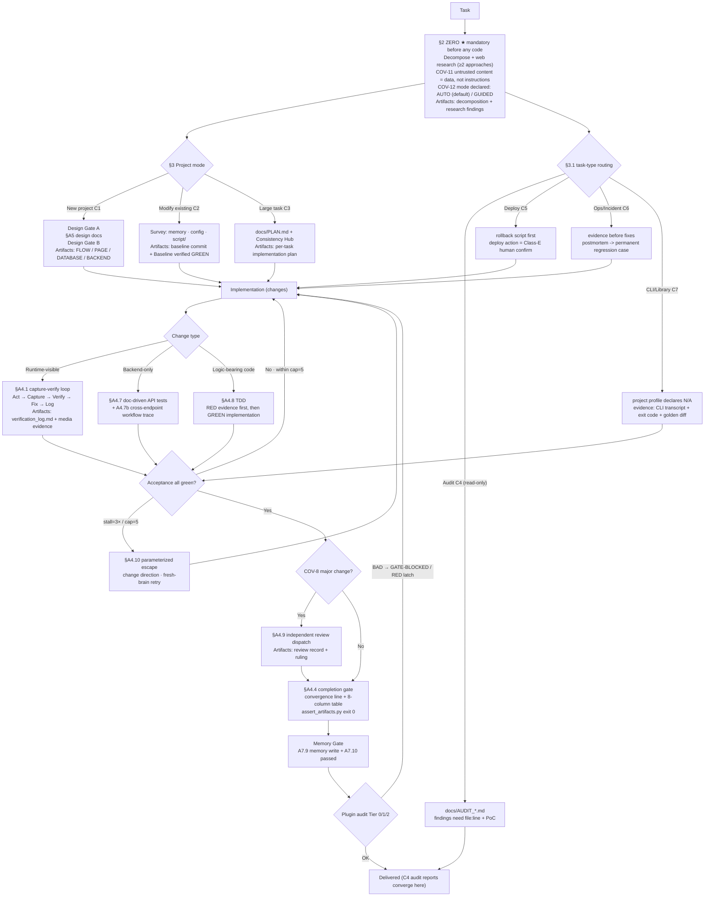

# vibeweaver-dsh

**The DeepSeek Harness (dsh) edition of the vibeweaver skill** — packages the [vibeweaver](https://github.com/logandoo/vibeweaver) coding discipline as a dsh plugin bundle (`engines.dsh: ">=0.1.0-rc.6"`, verified against 0.1.0-rc.6 / 0.1.5-rc.3 / 0.2.1-rc.3): the contract stays byte-for-byte identical, only the mechanical enforcement layer is swapped for dsh's Cordis plugin mechanism.

> This repository is the dsh-harness-specific release of vibeweaver: the original skill targets opencode, this edition targets DeepSeek Harness (jsonrpc-agent / headless CLI). It is not a general-purpose alternative.

## What it is

The spread of vibe-coding is reshaping the developer's role: once model coding ability stops being the bottleneck, the core of the job shifts from writing code yourself to organizing and managing the development process.

There is a counterintuitive fact here: model benchmark scores keep climbing, yet the real-world experience of coding-agent users on medium-to-large projects stays unsatisfying. The problem is not model capability; it is the two things left undefined in the development process — **the process** (how to work) and **the standards** (what counts as done, what counts as correct). The agent is not incapable — it just doesn't know what "done" means.

[vibeweaver](https://github.com/logandoo/vibeweaver) exists to solve exactly that: a coding discipline that constrains the coding agent with explicit contracts, turning model capability into stable, trustworthy delivery on medium-to-large projects. **vibeweaver-dsh is that contract, released for DeepSeek Harness.**

## The workflow is a graph, not a checklist

vibeweaver's contract is a directed graph: nodes are stages with mandatory artifacts, edges are explicit conditions, and every cycle is bounded (`cap=5` / `stall=3×`). The dsh edition runs the very same graph:



Traversal is soft, gating is hard: the model walks the graph by interpreting prose, but every guard condition is machine-checkable. The opencode edition enforces the final guard with a `tool.execute.after` hook; the dsh edition enforces it with the plugin mechanisms below.

## How the dsh edition enforces the gates mechanically


| Mechanism | What it does |
| --- | --- |
| **Progressive-disclosure covenant** | A compact covenant card (~2.2K tokens / 7.9KB, <8KB cap; wave3 adds COV-12 dual modes + task-type routing, 2026-09-30 adds COV-13 class declaration + §V11.9 render gate) stays resident in context; the full skill text loads on demand — replacing full-force injection (A/B benchmarks show a significant token reduction) |
| **Three-stage verifier tree (COV-5)** | In sync with the mainline: the probe `scripts/mm_probe.py` is **bundled with the plugin** (byte-identical to vibeweaver); the covenant card shows the source-dir path by default (it tracks the mainline) and falls back to the bundled copy only when the source dir has no probe — PASS → `model-native [image]` (self-read under the §A4.1.1 protocol); FAIL + mm-sensor → `mm-sensor [mode]` (independent grading); neither → `direct read` (DOM/log inspection) |
| **Auto-activation for coding tasks** | pre-step intent heuristics: the activation card is injected only for coding work; non-coding tasks cost nothing |
| **Mechanical gate** | Runs `assert_artifacts.py` after every write/edit, fail-closed (a stub checker, a crashed checker, or a non-zero exit with no structured `- ` failure lines all grade BAD); the project checker's sha256 must match the canonical pin, and the canonical checker runs preferentially when installed; `gate_mode: block \| warn \| off` — warn really means warn since w19.0 (advisory, never blocks) |
| **Pre-execution guards (w19.0)** | `tools/pre-execute` denies before dispatch: risk-tier paths need a `tests/decisions.md` approval line; destructive-command table (stage-everything, `reset --hard`, `clean -fd`, worktree discard, `truncate`, recursive delete off-allowlist); `- class: DOC` writing a source file is refused; paths normalized through realpath and dangling symlinks; `$HOME`/`$PWD` are not allowlist targets. Wave A adds the 0.2.x command face by registered name (`run_code`'s `code`, `terminal_send`'s `text`, `working_directory`'s `cd`), reducing recursive deletes and write targets inside programs back onto the same tables; unknown names still fail closed to the write face, and **prefix wildcards like `^terminal_` / `^mcp__` are banned** |
| **Content gates (2026-08-28 mainline sync; extended to 18 groups 2026-09-30)** | Assert failure messages are classified blocking by evidence semantics: groups 14-16 (`secret scan` / `test-change` / `risk-tier`) plus the 18-group additions (`DOC-asset render gate` / `exec-check`) plus claimed-evidence loss (`screenshot` / `media evidence`) plus the §V11.7 `--class` cross-check (`contradicts the log`) — a credential on an added wave-diff line blocks (unquoted safe reference values exempt), a removed test assertion without a `- test-change:` log reason blocks, touching high-risk paths (auth/payment/migration/…) without `tests/review_package.md` blocks, and an office asset without `render:`/`exec-check:` evidence rows blocks; a misreported task class is graded BAD by the assert `--class` cross-check and the completion audit (C18) — the gate path auto-detects the `- class:` line and does not itself judge misreports |
| **Turn guard** | steer budget (default 3) + mechanized stall observer (same file edited 3× with no new PASS → nudges toward §A4.10 parameterized direction change, preventing infinite loops) |
| **Compaction recovery** | The covenant card is rebuilt automatically after compaction, so long-task context survives |
| **User control** | `/vibe status` / `/vibe off` per-session switch; `VIBEWEAVER_GATE=off` global kill-switch |

## 2026-10-27: local runtime upgraded to 0.2.1-rc.4 + wave B (context-management port)

- **Local dsh upgraded.** `~/.dsh/profiles/node_modules` is a 597-link symlink farm over npx caches; it now points at a stable `~/.dsh/runtime/0.2.1-rc.4` (261 missing links added, including `dsh-working-directory`, which did not exist locally before). The old link map is kept for rollback; all four profiles compose.
- **Real-session E2E (criterion #7 closed).** On real dsh 0.2.1-rc.4 a coding task makes the plugin inject one message `{id:<uuid>, role:"user", source:{kind:"dsh-vibeweaver"}}`; reloading with `--session-id` yields **zero** corruption hits. Two negative controls on the real binary fail exactly where they should: old `kind:"plugin"` → `producer-owned source kind`; missing `id`/`role` → `lacks an identified message`. The smoke step is now a real assertion (still an honest SKIP without credentials).
- **Wave B (context management).** B1 delivers the working note **verbatim** (≤4KB, truncated) at every compaction boundary instead of three static lines; B2 snapshots it to disk so a distilled/deleted note is still deliverable; B3 emits one re-entry cue on the first write per (project, session) plus delivery telemetry in `.vibeweaver/state.json` (and fixes a stall-observer bug that reset that file wholesale, wiping the telemetry); B4 never injects the activation card into subagent sessions (`header.origin === "subagent"`, deliberately not fork lineage); B5 adds `§V9 shipping order` / `§V12 legal stops` to the covenant card, still **7789-7940B** across all 12 combinations.
- **Carry-over closed.** `engines.dsh` gained an upper bound `<0.3.0` (verified on the real runtime: out-of-range versions make dsh skip the bundle with an exemption command); four guard blind spots closed — absolute `/bin/rm`, backslash line continuation, `require('rimraf').sync`, and `os.exec*` argv `-c` payloads, each with a RED-before test.
- **Verification**: unit **171/171**; 26 guard PoCs; upstream v4-admission and real-cordis probes pass on rc.4; `assert_artifacts.py --existing` 59/59.

## 2026-10-26: dsh 0.2.1-rc.3 compatibility, wave A (two BLOCKERs + guard surface)

Per `docs/FIXES_20261026_dsh_compat_and_context.md`; every upstream claim was re-measured against an installed 0.2.1-rc.3 tree, not against docs:

- **A1 producer-owned, fully identified message source (BLOCKER-1)**: injected messages now carry `{kind:"dsh-vibeweaver"}` instead of `{kind:"plugin", …}` **and a real envelope (`id` + `role:"user"`)** — fixing only the kind was not enough: `dsh-agent-loop` persists `decision.messages` verbatim while the read side requires an identified message on every `user/message` (found by review R2 after the first fix shipped green). 0.2.x dropped the catch-all `plugin` kind: the write side still accepts it, while the **v4 read side throws `SessionFormatError`** (`worker.cjs:11641`) — a session that ever received an activation card could no longer be reopened. Older readers pass unknown kinds through, so this stays backward compatible. Certified without a model: `tests/v3_compat_probe.mjs` feeds the source `src/index.js` actually emits into upstream `assertV4RowAdmission`, including a negative control proving the old shape is rejected.
- **A2 effective working directory (BLOCKER-2)**: 0.2.x sessions can `cd` (`working_directory{cd}`), so the immutable `header.cwd` is no longer the effective directory and the gate silently disappeared after a `cd`. New `effectiveCwd()` reads `ctx.reflect.get("workingDirectory")?.get(session)` and falls back to `header.cwd`; all five call sites go through it. **Two deliberate deviations from the spec** (ADR D-11/D-13): the service name is *not* added to `inject` (cordis unloads a fiber whose inject list has an unimplemented name — on 0.1.x the whole plugin would vanish), and `cd` is not treated as a write path (that would let the evidence gate block a directory change); it warns instead.
- **A3 version gate**: `engines.dsh: ">=0.1.0-rc.6"` in package.json. Measured on 0.2.1-rc.3: an unsatisfiable range makes dsh refuse the bundle with an actionable message (rc.6 has no such gate). The smoke script now derives its version pin from `engines.dsh` (drift fails the run) and adds a reload-the-session step (0.2.x `--session-id`, capability-detected; reported as SKIP, never as pass).
- **A4 guard surface for 0.2.x tools**: `run_code` / `working_directory` / `terminal_open|send|signal` / `create_worktree` / `schedule_create|update` join the command face by name (**no prefix wildcards**); `lsp` is read-only per its actual parameters (ADR D-12). A `run_code` program issues no tool calls, so `shutil.rmtree('src')` used to bypass the guard entirely — it is now reduced to shell equivalents and judged by the same destructive table, while write/delete targets in code go back through the risk-path and protected-evidence guards. Multi-line payloads are scanned line by line; comment lines are exempt.
- **A5/A6 small fixes**: no "context was compacted" card when `compaction/end` carries `error`; the covenant section registers `interpolate: false` explicitly (0.2.x defaults to true).
- **Review hardening** (independent reviewer, 4 Important + 8 Minor, each adjudicated): the immutable `header.cwd` stays in the root-anchor list (one `cd` used to switch off the whole command-face guard set), command-face tools no longer enter the post-execute evidence gate (the action already happened; blocking only replaced its output), `create_worktree` warns because it also moves the session directory, and the A2 test double now validates its `get(Session)` argument — mutation testing had shown the old double let both "pass the wrong object" and "delete the resolver" pass green.
- **Verification**: `node --test tests/unit/*.test.js` **143/143** (baseline 121 + 22 new pins); `node tests/w19_poc.mjs` — original 15 verdicts unchanged, 11 added; `bash script/linux/project_build.sh` exit 0 with lib == src; covenant card 7820-7934B across all 12 combinations; `python3 tests/assert_artifacts.py --existing` exit 0.
- **Not in this wave**: wave B (context management B1-B6) and wave C (including the `engines.dsh` ceiling decision, ADR D-14).

## 2026-10-26: mainline w19.0 sync (trust floor port)

- **Canonical fast-forward**: `tests/assert_artifacts.py` is now byte-identical to mainline (sha256 `40090938…4ddaa`), gaining **group 22 (evidence lock)**, `--root` and `--self-check`. This repo had replayed five "fixed-local" patches onto every canonical refresh; a named, line-by-line check shows mainline absorbed all five, so the copy returns to zero local divergence.
- **Bundled scripts byte-synced**: `mm_probe.py` (C3d — the answer file now stores a whole-token PBKDF2 digest, so reading it no longer lets you compute the answer), `backlog_check.py` (C3e — mentioning a task ID is not evidence; the line must carry a command marker *and* exit code 0), `ui_fidelity.py` (section-number drift), plus the newly bundled `evidence_lock.py`.
- **Covenant card**: adds `COV-0 Delivery contract` (artifacts live on disk under `tests/`; the final answer carries results + an evidence summary, gate line only when the profile declares `final_gate_line: yes`) and `§A7.7.1 Unattended degradation` (CI/batch/eval runs must never stop or end on a question — record `- awaiting decision:` instead). Group count bumped to `组1-22`. Byte budget paid for by compressing COV-13 / task routing / COV-5 / content-gate lines (mainline itself delegated COV-13 detail to §V11.3); all 12 configurations (4 paths × block/warn/off) stay <8000B (measured 7820-7971B).
- **Pre-execution guards (`tools/pre-execute`)**: risk-tier paths (auth/security/payment/billing/crypto/migration/permission/acl) need a `- risk-approved:` line in `tests/decisions.md` before a write or a delete; six destructive-command rules (stage-everything, `reset --hard`, `clean -fd`, discard-the-whole-worktree, `truncate`, recursive delete outside the allowlist); a `- class: DOC` block writing a source file is denied outright. Tool names are matched by denylist (capitalised `Bash`, `multiedit`, `apply_patch` are all in scope) while explicitly read-only tools are never blocked — one place where dsh is stricter than mainline.
- **Checker trust**: the project copy's sha256 must match the canonical `scripts/assert_artifacts.sha256` (mismatch = BAD; `VIBEWEAVER_ALLOW_CUSTOM_CHECKER=1` overrides, forbidden in CI), and the read-only canonical checker runs preferentially with `--root` — **deleting `tests/assert_artifacts.py` no longer downgrades the gate to a two-line text floor**.
- **Protected evidence**: `acceptance.md` / `project_profile.json` / `debt_baseline.json` / `.evidence.lock` / the checker itself must pass `evidence_lock.py --check` before a write; only the script may write the lock; `verification_log.md` is append-only (`--seal-log` after appending).
- **Modes and runner**: `gate_mode: warn` now actually works (the config documented three modes, the code implemented two) — warn never blocks, it downgrades to a post-write `GATE-WARNING`, and the covenant card says so; `VIBEWEAVER_PYTHON` / `VIBEWEAVER_ASSERT_TIMEOUT_MS` override interpreter and timeout; `.vibeweaver/project.json` is a second activation marker, and a marker without a log yields a one-time `GATE-INACTIVE` notice instead of silence.
- **Deliberately not ported** (tracked in memory/known_gaps_upstream.md): lenient-flag preconditions (`--existing` requires `- profile:`) and `gate_result.json` · content-fingerprint cache (this repo still uses a 1s TTL + write invalidation) · working-note delivery at compaction · cue-delivery hardening · the Tier-0/1/2 audit plugin.
- Verification: `bash script/linux/project_build.sh` exit 0 with `lib/*.js` byte-identical to `src/*.js` · `node --test tests/unit/*.test.js` **121/121** · `python3 tests/assert_artifacts.py --existing --final` **53/53** · three review rounds (R1 trust model, R2 contract fidelity, R3 fix-round re-review) all needs-fix → iteration 5 landed 20 fixes · fresh-context verify 12/12 pass (tests/fcv_report.md).

## 2026-10-21: mainline W18 contract increment (batch 2/3)

- `tests/assert_artifacts.py` refreshed to canonical (22 markers; G3 shrink-only debt ratchet `--record-debt`, G4 claim-lint current block + `- claim-ack:`, G5 hand-typed hex lint, G6 strict-ancestor `- wave-base:`).
- `lib/lib.js` / `src/lib.js`: `countPasses` green grammar switched to `PASS\b` (aligning with COV-1); new `writePathFromArgs` (all three spellings file_path/path/filePath, mixed shapes fail closed); `src/index.js` resolves gate paths through it.
- Verification: build exit 0 · unit **73/73** · assert **49/49**.

## 2026-10-14: mainline uif port (§A4.1.2 design-copy fidelity + comparative probe + refboxes)

The two 10-14 mainline waves (§A4.1.2 measure-then-judge; `scripts/ui_fidelity.py` pixel/geometry instrumentation; the mm_probe comparative sub-probe and `refboxes` reference-image region extraction) land under the standing port discipline:

- **Covenant card** (still <8KB: four configs measured 7895/7945/7967B, all <8000 — including the production default and expanded paths): a new §A4.1.2 line — when acceptance criteria name copy fidelity, measure first, judge second: geometry/size/occlusion are certified only by instruments (`ui_fidelity.py diff/boxes`, `refboxes` for image references, `mm_probe --compare-*` for comparative calibration), and the VLM never certifies geometry; six obligation restores (review-adjudicated) offset by eleven redundancy compressions, net −57B (see this wave's log).
- **Scripts**: `scripts/mm_probe.py` refreshed to current mainline (comparative sub-probe: one-change panels × 5 variants, salted-hash ground truth, semantic selftest, protocol guard against reading the expected file); new `scripts/ui_fidelity.py` (pixelmatch v5.3.0 port + clustering + boxes overlap/occlusion + refboxes; stdlib only; `--selftest` 26 checks). Both byte-identical to mainline; package.json files updated.
- **Scope call** (ADR D-4): the assert has zero drift since 10-08 (not ported); loop-guard / memory-delivery / doc-debt waves have no card anchors (recorded, not ported).
- **Incidental debt cleared**: assert `--existing` 32/32 and `--final` 33/33 exit 0 (the baseline group-20 pre-existing failure is cured by this wave's new log block; one 2026-08-19 legacy diagnosis line was expanded to a substantive clause to satisfy the later wave16 12b lint — meaning preserved and annotated).
- **Verification**: unit 66→69 (new pins: card anchors + dual-config byte caps; script word + behavior anchors; lib mirror); `project_build.sh` exit 0 with lib==src.

## 2026-10-18: mainline repo-hygiene / 21-group assert / bounded-gate port

- **Assert**: `tests/assert_artifacts.py` refreshed to the mainline 21-group canonical. New group 21 enforces repo hygiene: `.gitignore` committed in HEAD and covering the detected stack, no tracked vendor/cache, untracked ≤2,000, `.git` ≤1 GiB, and reachable blob ≤40 MiB at `--final`; git errors/timeouts/overflow fail closed. The dsh fixed-local patches are now adopted upstream (including the shared `FINGERPRINT_EXT` contract); `--existing` passes 48/48 after the refresh.
- **Covenant card/lib**: COV-9 gains the group-21 hygiene preflight; the key-files group count is 1-21; `BLOCKING_HINTS` gains `repo-hygiene` (classification has been fail-closed since 2026-10-15b; the hint remains diagnostic); card is 7926B (7976B with the production default path) <8KB; `src/lib.js` → `lib/lib.js` is synced by `script/linux/project_build.sh`.
- **Stop-guard**: now wired through dsh-native `agent/turn-stopping` + `agent.steer`: if `tests/acceptance.md` exists but the current task block has no `- final-run:` and a successful write/edit happened after the last user message, steer to continue; host `agent/error` / aborted turn signals fence the trigger; user Q&A is turn-scoped and does not auto-resume; the existing `steerBudget` applies. No audit-plugin component is required.
- **Verification**: build exit 0; `node --test tests/unit/*.test.js` **73/73**; `python3 tests/assert_artifacts.py --existing` **48/48**; no in-repo A/B (standing dsh port discipline).

## 2026-10-07: mainline wave15–17 port (working memory · cue triggers · outer loop · enforcement teeth)

Three mainline waves ported under the standing discipline (C8 backlog outer loop; §A7.15 task working memory + §A7.16 cue-anchored triggers + 12b log lint + group 19/`--final`; stall latch + audit B12 + 4b trigger-prefix lint + backlog_check.py):

- **Covenant card** (still <8KB): new C8 route (backlog.json machine-checked `passes` + progress.txt append-only chronicle + one small item per fresh-context iteration + explicit stop signals + backlog_check.py), working_note key-file line (group 19 checks deletion on the `--final` run), the `triggers:` convention (safeGlob caps + 4b prefix lint), the `- final-run: --final` log-line obligation, and 12b placeholder-diagnosis = invalid iteration; the COV-1/8/12/§V11.9 lines were compressed byte-for-byte to fund them.
- **Mechanisms**: the stall observer gets the mainline latch (one report per stall signature, re-armed by a new iter entry); cueNotes/globToRegExp/parseTriggers/safeGlob ported wholesale, with delivery hoisted above the gate — the post-execute block feedback and the accept hints both carry cues.
- **Checker**: `tests/assert_artifacts.py` keeps the wave-2 five patches replayed and gains mainline 12b/4b/group 19+`--final` (the not-byte-identical rule stands; `memory/known_gaps_upstream.md` updated); `scripts/backlog_check.py` added.
- **Verification**: unit suite 65/65 (new groups: latch, cue hit/miss/self/budget/unquoted-inline, CRLF+BOM, card tokens, canonical groups present); 4b smoke-verified firing on the patched copy.

## 2026-09-30: dual-source update (dsh 0.2.0-rc.2 compatibility scan + mainline COV-13/§V11.9 port)

**dsh side**: npm-pack type-truth comparison from 0.1.0-rc.6 to 0.2.0-rc.2 (same methodology as the 08-29 scan) — every API shape the plugin uses (write/edit `file_path`, `PostToolDecision` accept/block, `agent/pre-step`/`turn-stopping`/`disposed`, `session/event`, `SkillProvider`, `systemPrompt.section`, `commands.register`) is byte-identical or additive-only; the removed `ctx.agent` / `agent/session-start` / `codeRuntime` surfaces were never used by the plugin. **Zero plugin code changes**; upgrading dsh to 0.2.0-rc.2 is safe for the plugin. Watch items: session storage v2→v3 for the bench, the `code`→`ptc` rename, and the adapter now reporting plugin package names by default.

**Mainline side**: ports the post-wave12 contract deltas — the covenant card gains **COV-13 class declaration** (`Class: CODE|CONFIG|DOC` by `git diff --stat` file kinds, CODE>CONFIG>DOC first-match, escalate-only; DOC = diff + read-back / lite 3-column table, CONFIG = smoke + baseline, CODE = full path; a `- class:` first log entry and a Class field in the gate line) and **§V11.9 DOC-asset render gate** (file-kind triggered: NO RENDER, NO DONE, one `render:` + `exec-check:` evidence row per asset, `Doc-skill: readme|docx|xlsx|pptx|none` declaration). The gate classifier now classifies the mainline 18-group assert additions (`DOC-asset render gate` / `exec-check`), the §V11.7 `--class` cross-check message (`contradicts the log`), and closes the `media evidence` claimed-evidence fail-open (ADR D-1, same failure class as the 08-28 port motivation) as blocking. **Review-Critical fix**: checker-crash detection now covers `SyntaxError` / `IndentationError` / `ETIMEDOUT` (a Python syntax crash previously landed in warnings = fail-open), and a non-zero checker exit with no structured `- ` failure lines always fails closed — the "shell script / crashed checker grades BAD" promise is now real. Root `tests/assert_artifacts.py` refreshed to the 18-group canonical (19-marker self-check). The stale COV-1..11 range in the activation/recovery texts is corrected to COV-1..13. Unit suite 43/43.

**wave-2 five-defect local patch (2026-09-30, user-directed, overriding the "no local canonical patches" ruling; hardened in review fix-round 1)**: this repo's `tests/assert_artifacts.py` carries hardening patches on top of the canonical — ① the first `- class:` entry wins and a later different class is a machine failure (de-escalation removed; indented/bulleted/spaced-colon/three-dash forms are all detected, fenced and blockquoted examples never license); ② `render:`/`exec-check:` rows bind to one exact asset (stems never cover siblings, same-basename different-dir assets require full-path rows, hyphen separators work, every cited page image must exist, the N/A form only covers zero-citation rows); ③ an empty class no longer inherits the Class-DOC COV-9 skip license (uncertain → higher; the skip is scoped to its task block); ④ the group-17 remediation template shows the accepted concrete-tool form (`N/A (soffice missing)`); ⑤ untracked assets are detected from the single-column `ls-files --others` output (including capital-`D` paths, with git C-quote/octal path decoding); the exec verdict is the anchored token after the separator (`unclean`/`NOT clean` no longer launder the gate). **The copy is no longer byte-identical to the mainline canonical** — any canonical refresh must preserve/replay these patches (list + documented residuals in `memory/known_gaps_upstream.md`, local work-state). Known residuals the machine does not judge (completion-audit C18 territory): cross-block `## ` heading manipulation, and the N/A missing-tool self-assertion (a contract-allowed form). Unit suite 60/60.

## 2026-09-14: mainline wave7 port (trusted oracle + checker contract)

Mirrors the mainline [wave7](https://github.com/logandoo/vibeweaver) (the fifteen-arm result: a deterministic loop only pays when it is fed a trusted oracle — real tests 4/4, self-written tests 1/4, generated tests 1/4 with false greens). The covenant card's COV-1 line gains the trusted-oracle clause: only project/external tests (or executable acceptance criteria) certify a task; generated tests must pass qualification (stub fails, gold passes, plausible-wrong fails) and remain weak evidence; self-written tests are weakest; an invisible contract is flagged, never invented; a project checker (`vw_check.py` / `script/check.sh`) is the loop's feedback. No A/B here (the mainline ran it: ds 16 tasks 13/16 → 16/16; qwen 8-task subset 4/8 → 3/8). Wave 6 carried no contract delta (covenant text unchanged). Unit suite 35/35.

## 2026-08-30: mainline wave5 port (spike routing + task right-sizing)

The mainline wave ([vibeweaver@e751ada](https://github.com/logandoo/vibeweaver)) compared against the full obra/superpowers repo and adopted two: a new S1 spike route in §3.1 (a feasibility question delivers an answer, not code; output stays throwaway; keeping it = a new request with its own baseline) and a task right-sizing test for C3 plans (split only where a reviewer could reject one task while approving its neighbor). Eight more were rejected on the record. One thing moved on the dsh side: the covenant card's task-routing line gains the spike branch (2-3 sentence probe plan, cheapest correct probe, throwaway code, keeping = new request). The right-sizing test is C3 plan-layer detail with no card anchor; full text stays with the skill source. Unit tests 35/35.

## 2026-08-30: mainline wave4 port (five contracts borrowed from mattpocock/skills)

The mainline wave ([vibeweaver@0d6da0e](https://github.com/logandoo/vibeweaver)) did a read-only comparison against mattpocock/skills and adopted five: C3 test seams, the A4.9 spec-fidelity triad, the Fowler twelve-smell reviewer baseline, GUIDED frontier rounds, and the proactive-ADR three-criteria test. Four more were evaluated and rejected on the record (issue-tracker publishing, pathless specs, dual-axis parallel reviewers, CONTEXT.md glossaries). Two things moved on the dsh side:

- The covenant card's COV-8 line gained two short clauses: Compliance must report the spec-fidelity triad (missing/partial · scope creep · looks-implemented-but-wrong, quoting the criterion line), and the review package carries the Fowler smell baseline (repo standards override; every smell a judgement call).
- The covenant card's COV-12 pause protocol gained one sentence: in GUIDED, a multi-question pause runs as dependency-ordered rounds (each question with a recommended answer, blocked questions wait for the next round, facts are looked up not asked, empty frontier = nothing silently assumed).
- C3 test seams and the ADR criteria have no card section to anchor to (the card doesn't carry C3/ADR detail); full text still loads from the skill source, no duplicate maintenance. Unit tests 35/35.

## 2026-08-29: mainline wave3 port (dual modes + task types)

The mainline wave ([vibeweaver@a01d413](https://github.com/logandoo/vibeweaver)) tackles two recurring annoyances: the agent stopping mid-task to wait for a human "continue", and audit/deploy/ops work having no workflow at all. Four-round re-run average: 92.5% vs 87.5% before — direction positive. Three things moved on the dsh side:

- The covenant card gained COV-12: every task declares AUTO (default — questions become one-line ADRs in `tests/decisions.md`, then the agent keeps going) or GUIDED. Irreversible things (production deploys, destructive ops, injection conflicts) stop in both modes, every stop carries `[PAUSED] ... default-if-continue=...`, and "continue" approves the default. The card is 2.9KB now — far from the 8KB line.
- One task-type routing line joined the card: audit C4 / deploy C5 / ops C6 / non-web C7. Full text still loads from the skill source's `WORKFLOWS_EXTENDED.md`; the plugin doesn't keep its own copy.
- `tests/assert_artifacts.py` refreshed to the mainline canonical (17 markers): library/CLI projects can declare a profile and skip the start.sh group; a `vw-approved` exemption requires the paired `- secret-approved: <path>` log line — mentioning it in a comment doesn't count. Unit tests 32/32.

## 2026-08-28: mainline AI-native SDLC hardening port

Mirrors the mainline 2026-08-28 wave ([vibeweaver@6567e51](https://github.com/logandoo/vibeweaver)): the completion gate moves from "does evidence exist" to "what does the diff contain". This wave ports the same rules into the dsh plugin (no A/B here — the mainline already ran the deepseek-v4-flash forced-injection before/after benchmark: 15/16 → 16/16, artifact adherence 6/10 → 9/10):

- **Gate classification sync**: `BLOCKING_HINTS` gains `secret scan` / `test-change` / `risk-tier` — group 14-16 failure messages now block in the dsh gate (groups 14/16 previously fell through as warnings). Group 14 `secret scan` (per-commit wave diff + untracked-file sweep; AKIA / private-key blocks / `ghp_`/`github_pat_`/`sk-proj-`/`sk-ant-` / JSON-form k=v; `os.environ`/`process.env`/`config.x`/`self.x` reference values exempt, `.md` warn-only); group 15 `test-change guard` (removed assertion lines require a logged reason, whole-file deletion included); group 16 `risk-tier` (high-risk code paths require `tests/review_package.md`).
- **Covenant card sync**: COV-8 extended (risk-tier non-skippable + findings tagged `Bugs`/`Security`/`Compliance` + Minor cap 5 itemized) + a content-gates line + an agent-config regression line (editing `CLAUDE.md`/`.claude/**`/skill rule files requires re-running the verification suite). Card stays < 8KB.
- **Fixture-first**: 3 new unit tests went RED first (classification / card / gate integration — a real git fixture committing a credential gets blocked), then the full suite went GREEN at 35/35; this repo's own root `assert_artifacts.py` refreshed to the 16-group canonical.
- Pure-documentation rules on the mainline side (§A4.4.3 Artifact Chain, §A9 incident postmortem, cross-project ⛔ promotion, production-deploy human-confirm) are inherited through the card's "load the full rules from the skill source" path (source already synced) — no plugin code needed.

## The evidence: plugin vs force-injection

8 tasks × 2 arms A/B (dsh 0.1.0-rc.6 headless · deepseek-v4-flash · repeats=1):

- **Arm-A (baseline)** = full SKILL.md statically injected into the system prompt (the strongest force-injection form)
- **Arm-B (this plugin)** = covenant card + on-demand skill + mechanical gate + turn guard

| Task | Type | A (injected) tokens | B (plugin) tokens | Verdict |
| --- | --- | --- | --- | --- |
| t01 new project CLI | New project | 149,624 | **137,574** | B saves 8% |
| t02 new project API | New project backend | 151,503 | **146,108** | B saves 4%, turns -35% |
| t03 fix bug | Modify-Existing | 224,251 (**runaway**, zero gate artifacts) | **152,396** (all ✓ + assert 12/12) | B saves 32%, only compliant arm |
| t04 Playwright UI | UI flow | 165,891 | **157,316** | B saves 5% |
| t07 trivial config | Negative control | **39,816** | 96,821 | A wins (activation cost on trivial tasks — a known trade-off) |

**Key evidence**: t03-A, with full injection, ran away on a mid-complexity task — 224K tokens, 100 turns, a web_search loop, and zero gate artifacts; t03-B on the same task got its activation card at step 1 → TDD RED→GREEN → A4.9 independent review → regression loop → assert 12/12.

**Conclusion**: on substantive coding tasks the plugin form achieves compliance ≥ and token usage < force-injection, satisfying the pre-registered criterion (B compliance ≥ A and tokens ≤ A) — it is the recommended packaging of vibeweaver for dsh. Known caveats: t05/t06 excluded due to an external API failure; repeats=1.

## Architecture

| Component | Files | Mechanism |
| --- | --- | --- |
| Plugin entry | `src/index.js` → `lib/index.js` | `apply(ctx, config)` event wiring |
| Arm-A baseline plugin | `src/baseline.js` → `lib/baseline.js` | full SKILL.md static injection (bench control arm) |
| Pure-function core | `src/lib.js` | project-root discovery / assert execution / gate classification / stall observer / intent heuristics / covenant card |
| Vision probe | `scripts/mm_probe.py` | self-multimodality behavioral probe (byte-identical to vibeweaver, bundled with the plugin; falls back to the skill source dir when missing) |
| Bundle mounting | `package.json` + `cordis.patch.yml` | `dsh.bundle.patch` → `insert: [{id, name}]` |

## Installation

```bash
# 1. Clone this repo and make sure the vibeweaver skill source directory exists
#    (default: ~/.config/opencode/skills/vibeweaver).
#    You can obtain the vibeweaver SKILL.md from the vibeweaver repository and place it there.

# 2. Mount into a dsh profile (replace <path/to/vibeweaver-dsh> with your local path)
dsh plugin --profile web add file:<path/to/vibeweaver-dsh>

# 3. Verify it is active
dsh --profile web --dump-config | grep -A3 dsh-vibeweaver
```

> Paths note: `skill_source_dir` / `session_root` in `config.toml` / `cordis.patch.yml` are example paths (`~` placeholder). Adjust them to your machine before deploying, or override via the `VIBEWEAVER_SKILL_DIR` environment variable.

## Configuration

`config.toml` (plugin runtime + bench config; overridden by the profile's plugin config at deploy time):

```toml
[plugin]
skill_source_dir = "~/.config/opencode/skills/vibeweaver"  # skill source directory
steer_budget = 3        # max steers per turn guard
gate_mode = "block"     # block | warn | off
pre_step_activation = true
recover_after_compaction = true

[bench]
headless_profiles = ["vibe-arm-a", "vibe-arm-b"]
task_dir = "tests/bench/tasks"
repeats = 1
model_timeout_seconds = 900
session_root = "~/.dsh/sessions"
```

Set the environment variable `VIBEWEAVER_GATE=off` to kill-switch the gates.

## Development & Benchmarking

```bash
bash script/linux/project_build.sh   # src → lib (node --check + copy)
node --test tests/unit/              # unit tests (node:test)
bash script/linux/bench_profiles.sh  # create vibe-arm-a / vibe-arm-b headless profiles
bash script/linux/bench.sh           # A/B benchmark → tests/bench/report.md
bash script/linux/smoke.sh           # headless smoke test
```

## Dependencies

- Node.js ≥ 20 (zero npm runtime dependencies)
- dsh `>=0.1.0-rc.6` (`engines.dsh`; all three runtimes — 0.1.0-rc.6, 0.1.5-rc.3, 0.2.1-rc.3 — verified to load the bundle)
- Python 3.11+ (scoring scripts / assert_artifacts.py; `tomllib` requires 3.11+)
- pnpm (bench profile install)

## License

MIT


## Port note 2026-10-15b

Bidirectional reconciliation with the mainline hardening wave: assert_artifacts merges mainline P0/P1 (fail-closed JSON, C1 derived class, C2 media validation, seal manifest, per-block COV-9) with this side's hardening (first-entry class, _unquote_git, per-asset binding, exec verdict); lib.js ports D4 fail-closed (BLOCKING_HINTS retired); card wording E2' + <8KB held; unit 69/69, assert --existing --final 40/40.
